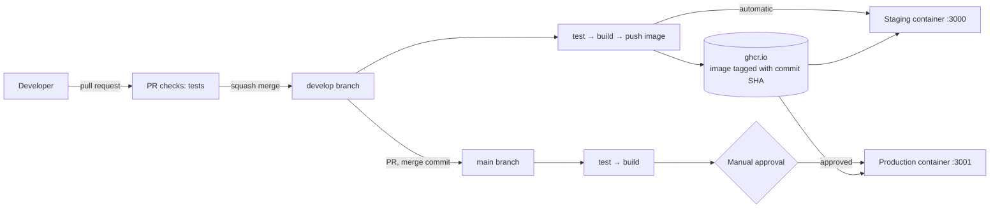
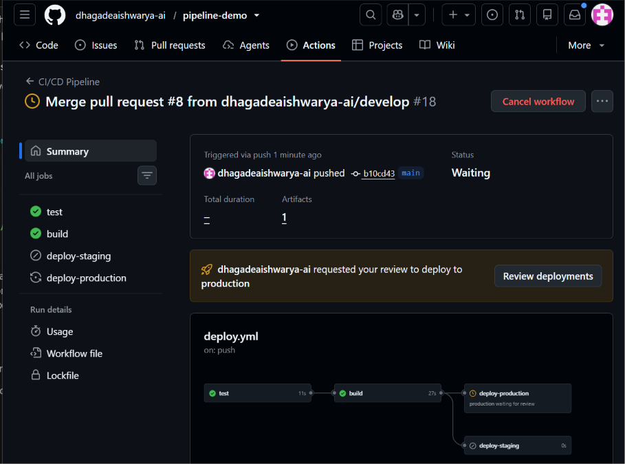

# pipeline-demo: Multi-Environment CI/CD Pipeline

A small Node.js app with a complete delivery pipeline: tests on every pull request, a Docker image pushed to GitHub Container Registry, automatic deploys to **staging**, and **production** deploys behind a manual approval gate.


## Architecture



Both environments run as separate containers on one EC2 instance (ports 3000 and 3001).

## Pipeline behaviour

| Event | Jobs that run |
|---|---|
| Pull request into `develop` or `main` | `test` only |
| Push to `develop` | `test` → `build` → `deploy-staging` (automatic) |
| Push to `main` | `test` → `build` → `deploy-production` (**waits for approval**) |



## Key design decisions

- **Images are tagged with the commit SHA.** Each running container maps to exactly one commit, and a rollback is just running an older tag.
- **Images are built only on push, never on pull requests,** so unreviewed code never reaches the registry.
- **Least-privilege tokens:** the workflow is read-only by default, and only the build job gets `packages: write`.
- **GitHub Environments** hold separate secrets for staging and production. Production deploys are restricted to the `main` branch and require a reviewer.
- **Health checks:** every deploy polls `/health`, and the job fails if the app doesn't answer.
- **Branch protection:** pull requests and a passing `test` check are required before merging.

## Run it locally

```bash
npm ci
npm test
docker build -t pipeline-demo:local .
docker run --rm -p 3000:3000 -e APP_ENV=local pipeline-demo:local
curl localhost:3000/health
```

## Secrets required

| Environment | Secret | Purpose |
|---|---|---|
| staging | `STAGING_HOST`, `STAGING_SSH_KEY` | Address and deploy key for the staging server |
| production | `PROD_HOST`, `PROD_SSH_KEY` | Address and deploy key for production |

The deploy key belongs to a dedicated, non-admin `deploy` user on the server.

## Rollback

Every image is available by commit SHA. To roll back production, run on the server:

```bash
docker rm -f production
docker run -d --name production --restart unless-stopped -p 3001:3000 \
  -e APP_ENV=production -e APP_VERSION=<OLD_SHA> \
  ghcr.io/<username>/pipeline-demo:<OLD_SHA>
```

The next merge to `main` redeploys the latest code, so revert the faulty commit through a pull request to make `main` match what is running.

## Known limitations

- Staging and production share one server. A real setup would separate them.
- Deploys use SSH keys stored as GitHub secrets. Moving to OIDC with AWS-native deployment would remove stored keys.
- The `deploy` user is in the `docker` group, which is effectively root on that host.
- No HTTPS, domain name, or monitoring.
- Rollback is manual over SSH.

## Next steps

Move the registry to Amazon ECR using GitHub OIDC, add CloudWatch monitoring, and add a `workflow_dispatch` rollback that goes through the approval gate.